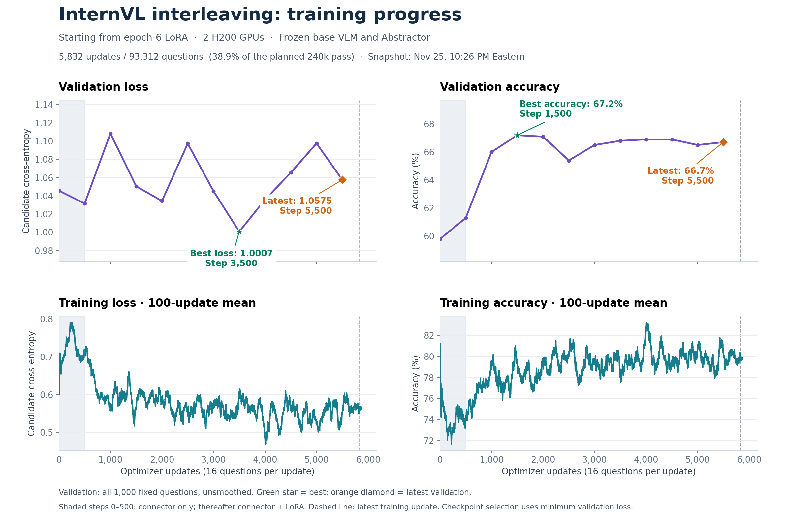

# InternVL interleaving: epoch 6 then epoch 4

Snapshot: **2026-11-25 10:26 PM Eastern**. Training source:
[`44ac9c7`](https://github.com/prathamsunkad/relationalreasoningVLM/commit/44ac9c74da42ed56d94d8798d24d2f8b0745a7a0)
on `internvl-interleave-20pct` (renamed from `codex/internvl-interleave-20pct`).
This later record-only commit does not
change the immutable source bundle running on PACE.

## Status and results

Two allocations completed cleanly, most recently at 8:56 p.m. Eastern on
November 25. Together they used 7h 31m 24s on two H200s (15.05 GPU-hours).
Progress is saved at **5,832 updates / 93,312 unique questions**, 38.88% of the
240k-question pass. Continuation **7305937** is pending priority; epoch-4
training has not started. Both correctness pilots passed. Allocation completion
is not epoch completion: `complete=false`, `stop_reason=allocation_boundary`
is an expected continuation. No early stop has triggered and no benchmark test
was run.

| Validation checkpoint | Update | Questions processed | CE loss | Accuracy (1,000 questions) |
|---|---:|---:|---:|---:|
| Before connector training | 0 | 0 | 1.0457 | 59.8% |
| Selected: minimum validation CE | 3,500 | 56,000 | **1.0007** | 66.8% |
| Highest validation accuracy so far | 1,500 | 24,000 | 1.0505 | **67.2%** |
| Latest validation | 5,500 | 88,000 | 1.0575 | 66.7% |

Step 0 already includes the untrained connector, so it is not a LoRA-only
baseline. The latest training update is 5,832; the latest validation is 5,500.
The next scheduled validation is update 6,000. Subsequent checks have not
improved the selected update-3,500 checkpoint; this partial run does not yet
establish convergence.



[PDF figure](figures/progress-marked-20261125-2226.pdf) ·
[Machine-readable figure summary](figures/progress-marked-20261125-2226.json) ·
[Validation CSV](figures/epoch6-loss-accuracy-20261125-2226.csv)

## Setup

InternVL3.5-1B-HF starts from the existing PGM epoch-6 LoRA checkpoint.
A frozen pretrained Slot Abstractor supplies pooled relations through a fresh
two-layer GELU MLP as one interleaved relation token. Candidate scores are
Yes-minus-No logits; training uses eight-way cross-entropy. Original VLM and
Slot Abstractor weights remain frozen. Updates 1–500 train only the connector;
from update 501, connector and existing language LoRA train together.
Connector LR is 1e-4 (50-update warm-up), LoRA LR is 2e-5, then cosine decay to
10% at update 15,000. Global batch is 16 across two H200s. Validation runs every
500 updates on the same 1,000 questions; checkpoint selection minimizes CE.

Data is the fixed 240,000-question PGM neutral official-train subset (20% of
1.2M), with the cached 60,000-question subset first and remaining features
cached during training. The epoch-4 experiment will use its own starting LoRA
and fresh connector. Six unimproved post-warm-up validations, considering
both loss and accuracy plus a median-trend guard, can end each run early.
Exact hashes, rates, stopping thresholds and paths are in the plans below.

## Code and records

- Training: [`tools/train_distributed_interleave.py`](../../../tools/train_distributed_interleave.py),
  [`tools/train_cached_interleave.py`](../../../tools/train_cached_interleave.py).
- Continuation dispatcher: [`tools/dispatch_interleave_allocation.py`](../../../tools/dispatch_interleave_allocation.py).
- Slurm entry points: [`distributed_interleave_pilot.sbatch`](../../../slurm_portable/slurm/distributed_interleave_pilot.sbatch),
  [`distributed_interleave_train.sbatch`](../../../slurm_portable/slurm/distributed_interleave_train.sbatch).
- Exact campaign and checkpoint plans: [`records/campaign.json`](records/campaign.json),
  [`records/ep6-plan.json`](records/ep6-plan.json), [`records/ep4-plan.json`](records/ep4-plan.json).
- Per-update training, validation and stopping curves: `records/epoch6/*.jsonl.gz`.
- Progress, configuration, selected-checkpoint pointer, validation predictions and
  allocation summary: `records/epoch6/`.
- Correctness/replay checks and pilot summaries: `records/pilot-epoch6/`,
  `records/pilot-epoch4/`; runtime preflight and terminal logs: `records/`.
- Job receipts: [`records/jobs.json`](records/jobs.json); queue/accounting at capture:
  [`scheduler-snapshot.json`](scheduler-snapshot.json).
- Figures: `figures/`; best/latest annotations: [`plot_marked_curves.py`](plot_marked_curves.py);
  overlaid curves and validation CSV: [`plot_curves.py`](plot_curves.py).
  Older dated figures remain historical snapshots.

From the repository root:

```bash
python3 results/internvl_interleave/2026-11-24-two-gpu/verify.py
# Requires matplotlib and numpy; no GPU or weights needed:
python3 results/internvl_interleave/2026-11-24-two-gpu/plot_curves.py
python3 results/internvl_interleave/2026-11-24-two-gpu/plot_marked_curves.py
```

`PROVENANCE.json` verifies exported SHA256 and original remote SHA256 after
lossless decompression. Plans and logs retain original PACE paths for provenance;
models, data, optimizer state and feature banks remain external. This snapshot
supports auditing the current partial run, not a claim of full-epoch or test
results. Training curves use a trailing 100-update mean; validation is unsmoothed.

## Completed averaging control

The [November 25 averaging archive](../2026-11-25-average-control/README.md)
contains the original epoch-6 LoRA and Abstractor scores, untuned averaging,
and the pinned update-3,500 hybrid comparison on the same 1,000 validation IDs.
Primary averaging reaches 66.7% versus hybrid 66.8% (paired p=1.0); no hybrid
advantage is demonstrated. Raw predictions, checksums, logs and a CPU-only
verification command are included. These are validation results.
