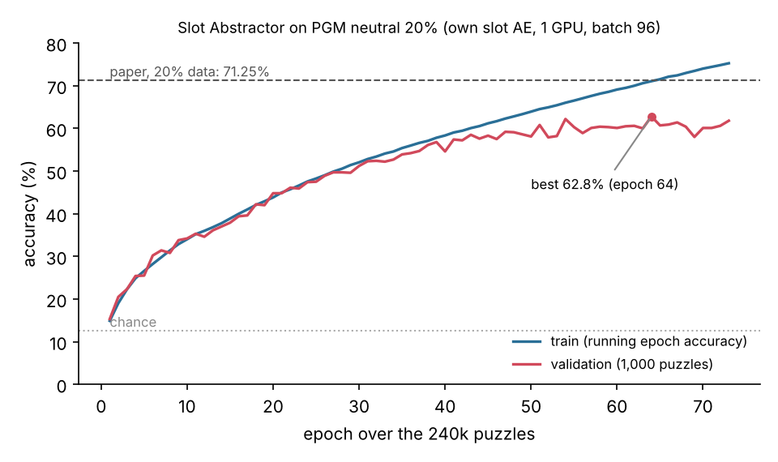

# slot_abstractor: the Slot Abstractor baseline on PGM neutral, 20% data

This folder holds the task-specific baseline that the VLMs are compared with: the **Slot Abstractor** (Mondal et al.,
ICML 2024). Its architecture is a CNN encoder, slot attention, then a 24-layer Abstractor, and it is trained from scratch.

- **Data:** the same 240k training puzzles (seed 20261007) as the repo's LoRA runs, read from the contact-sheet
  package (JSONL + one PNG sheet per puzzle). It is validated on the same 1,000 validation puzzles.
- **Use in Exp2:** `gap_hybrid_probes/exp2/` loads this model, frozen, through `exp2/sa_builder.py`.

## Results so far



| | |
|---|---|
| Slot autoencoder | pretrained (reconstruction only, no labels) on the panels of the **240k only** (`pretrain_slot_ae_pgm.py`) |
| Training | 1 H200, batch 96 (= the paper's 4 GPUs × 24), Adam lr 8e-5 constant, depth 24, context norm; ~73 min per epoch |
| Best validation | **62.8%** after epoch 64 (train 71.1%) |
| Latest logged | epoch 73: train 75.3%, validation 61.8%; the run is set to 80 epochs |
| Test (200k) | **not run yet** (`sa_test.sbatch`) |
| Paper, 20% data | 71.25% test (Table 5) |

- **Validation has levelled off.** It has stayed between 58% and 63% since about epoch 50, while training accuracy
  keeps rising (64% → 75%). More epochs are unlikely to help much.
- **Why it sits 8 points below the paper:** this run sees only the 240k puzzles, slot autoencoder included. The
  paper's autoencoder was pretrained on all 1.2M puzzles (by its file name), and the paper's 20% sample is different
  and can't be reconstructed. One run, one seed.
- **Comparison with the VLMs:** on the same 240k puzzles, the fine-tuned InternVL3.5-1B reaches 57.73% / 60.31% test
  and Qwen3-VL-2B 81.50% / 82.06% (`results/lora/`). Those are test numbers; this table's 62.8% is validation (1,000
  puzzles, ±3 points).

Curve data: `results/val_curve.csv`, rebuilt from the logs with `python summarize_runs.py`. The job logs are in
`run_logs/`. Weights are not in git.

## What is ours and what is the authors'

| File | Origin | What it does |
|---|---|---|
| `slot_abstractor_pgm.py`, `util.py` | authors, unchanged | model: slot autoencoder, Abstractor, `scoring_model` |
| `train_slot_abstractor_pgm.py`, `test_slot_abstractor_pgm.py`, `run_*_job.slurm` | authors, unchanged | their training / test on per-puzzle `.npz` files (4 GPUs, `srun`) |
| `pgm_jsonl_data.py` | ours | reads the JSONL + sheets; crops the 16 panels with `layout.json`; the authors' transform ([-1, 1], 80×80) |
| `run_pgm_jsonl.py` | ours | train / test with the authors' model, loss and optimiser on the JSONL data. Also: exact multi-GPU accuracy, resume (mid-epoch too), walltime stop, per-question predictions |
| `pretrain_slot_ae_pgm.py` | ours | slot autoencoder pretraining on the 20% only (the authors' checkpoint is not released and used 100% of the data) |
| `jsonl_to_npz.py` | ours | converts the JSONL package to the authors' `.npz` format (to run their scripts unchanged) |
| `infer_layout.py`, `layout.json` | ours | panel boxes on the 700×1016 contact sheet |
| `sa_pretrain_ae.sbatch`, `sa_train.sbatch`, `sa_test.sbatch`, `env_local.sh` | ours | 1-GPU jobs (what produced the results above), paths in `env_local.sh` |
| `ice_*.sbatch` | ours | the same steps on 4 GPUs (the paper's layout) |
| `summarize_runs.py` | ours | learning curve from the logs; test mean ± sd over seeds |
| `README_original_kit.md` | ours | the original setup notes (step-by-step, both options, caveats) |
| `other/` | ours | ART environment check (not used for PGM) |

Add the authors' repository link and license here before making the repo public.

## Run (from this folder)

Set `SHEET_DATA`, `SA_CONDA_ENV` (an env with torch, torchvision, einops, colorlog) and `SA_WEIGHTS` in
`env_local.sh`. Then:

```bash
mkdir -p logs
sbatch sa_pretrain_ae.sbatch     # 1. slot autoencoder, 300k steps; resubmit until "finished"
sbatch sa_train.sbatch           # 2. Slot Abstractor, 80 epochs; resubmit after each 6 h job (resumes mid-epoch)
sbatch sa_test.sbatch            # 3. best checkpoint on validation + the 200k test, seeds 0, 1, 2 (~1 h each)
python summarize_runs.py --csv $SA_WEIGHTS/slot_abstractor_pgm_pgm20_1gpu_d24_lr8e-05_run0_log.csv   # curve
```

Before training, check the crops once (CPU): `python pgm_jsonl_data.py --root $SHEET_DATA --layout layout.json` writes
`pgm_check.png`, the 16 panels as the model sees them. Examples are in `results/figures/`.

**Checkpoints** (`$SA_WEIGHTS`, not in git):
- `slot_ae_pgm20.pth.tar`: `{"slot_model_state_dict"}`
- `slot_abstractor_pgm_pgm20_1gpu_d24_lr8e-05_run0_{best,last,epNN}.pth.tar`:
  `{"abstractor_model_state_dict"` ('module.' keys), `"optimizer_state_dict"`, `"epoch"`, `"max_val_acc"`, `"args"}`
- `..._log.csv`: one row per epoch
- `<ckpt>.seed<k>.eval.json` and `.test_preds.csv`: test results

## Reproducibility notes

- **Slot initialisation is random,** so evaluation accuracy varies with `--seed`. `sa_test.sbatch` runs 3 seeds;
  report mean ± sd.
- **Resizing depends on the torchvision version.** The 160 → 80 px resize antialiases in torchvision ≥ 0.17 and not
  in older versions; record `torchvision.__version__` of the env you train in.
- **Compute:** about 73 min per epoch on one H200, so 80 epochs is roughly 100 GPU-hours (17 six-hour jobs).
